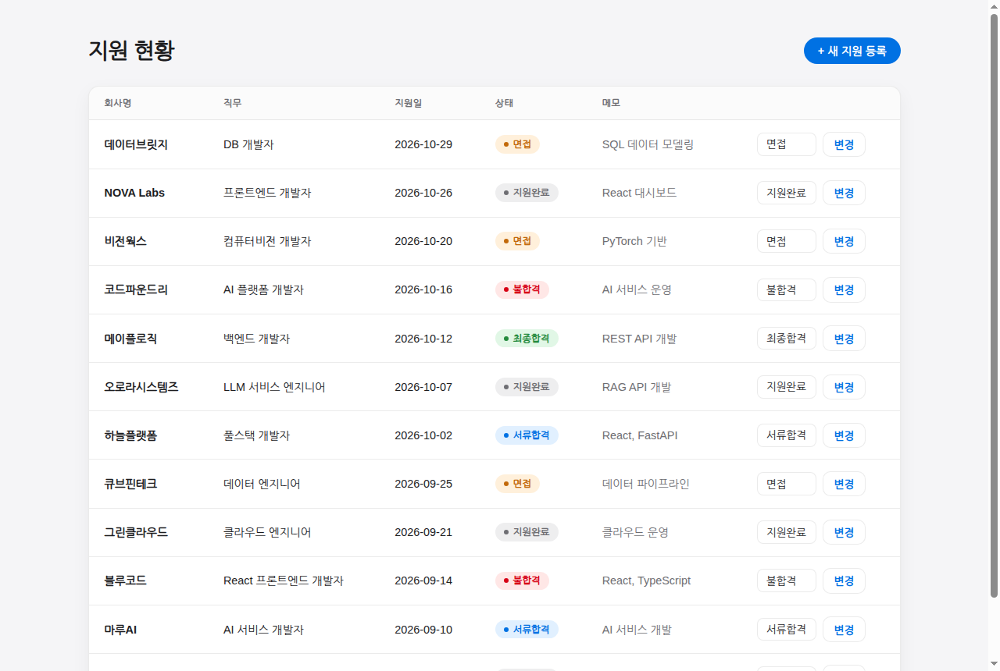
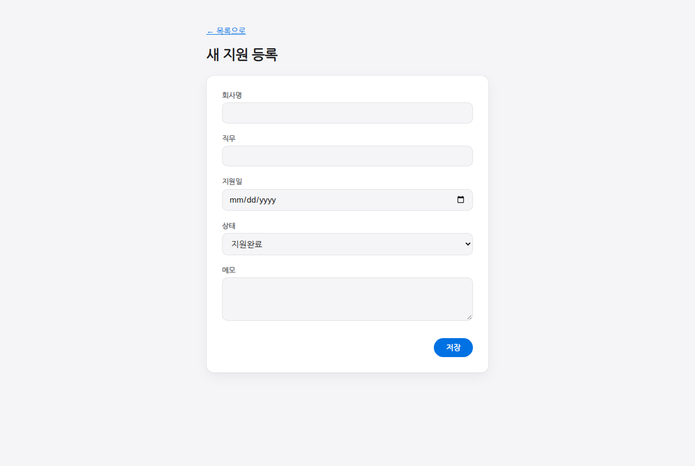

<div align="center">

# gg1th_jobtracker_harness_ex

**하네스 엔지니어링 실습 — 채용 지원 현황 관리 웹앱 JobTracker**

가이드 문서와 테스트로 AI 코딩 에이전트의 작업 범위와 완료 기준을 먼저 정한 뒤 앱 구현을 맡긴 실습




</div>

<br>

## 주요 기능

- **목록 조회** — 회사명 · 직무 · 지원일 · 상태 · 메모를 지원일 최신순으로 표시
- **지원 등록** — 입력 5칸 폼, 오류는 같은 화면에 메시지로 표시
- **상태 변경** — 행마다 드롭다운에서 5가지 상태(지원완료 · 서류합격 · 면접 · 최종합격 · 불합격) 중 하나를 골라 [변경]
- **입력 검증** — 양끝 공백 제거, 필수값 · 실제 존재하는 날짜 · 미래 날짜 거부, 회사명 + 직무 중복(대소문자 무시) 거부. 화면과 API가 같은 검증 로직(`app/validation.py`) 사용
- **초기 데이터** — 첫 실행 시 DB가 비어 있으면 시드 12건 자동 적재, 데이터는 SQLite 파일에 유지

<br>

## 하네스 구성

AI에게 코드를 맡기기 전에 "무엇을 만들지"와 "언제 끝난 것인지"를 파일로 고정했다.

| 단계 | 장치 | 파일 |
|---|---|---|
| 0 | 요구사항 정의 | [`docs/JobTracker_프로젝트정의.md`](docs/JobTracker_프로젝트정의.md) |
| 1 | 가이드 — 기술 스택, 데이터 규칙, API, 화면, 하지 않을 것, 완료 기준 | [`CLAUDE.md`](CLAUDE.md) |
| 2 | 센서 — 입력 케이스 12개 + 미래 날짜 거부 TC13 | [`tests/`](tests/), [`input_data/api_test_cases.json`](input_data/api_test_cases.json) |
| 3 | 구현 — 가이드를 따르고 테스트가 전부 통과할 때까지 앱 코드만 수정 | [`app/`](app/) |

단계별로 사용한 프롬프트는 [`docs/사용한 프롬프트.md`](docs/사용한%20프롬프트.md)에 정리했다.

<br>

## API

| 메서드 | 경로 | 성공 | 실패 |
|---|---|---|---|
| `GET` | `/api/applications` | 200, 지원일 최신순 목록 | |
| `POST` | `/api/applications` | 201 | 422 입력 오류, 409 중복 |
| `PATCH` | `/api/applications/{id}/status` | 200 | 404 없는 ID, 422 상태 값 오류 |

상태는 영문 코드로 저장하고 화면에는 한글로 표시한다.

| 코드 | `applied` | `document_passed` | `interview` | `final_passed` | `rejected` |
|---|---|---|---|---|---|
| 표시 | 지원완료 | 서류합격 | 면접 | 최종합격 | 불합격 |

<br>

## 화면

| 목록 `/` | 등록 `/new` |
|---|---|
|  |  |

<br>

## 프로젝트 구조

```
gg1th_jobtracker_harness_ex/
├── CLAUDE.md               # 하네스 가이드 (스택 · 규칙 · 완료 기준)
├── app/
│   ├── main.py             # 라우트 (API + 화면)
│   ├── db.py               # get_db() 의존성 · 스키마 생성 · 시드 적재
│   ├── validation.py       # 화면 / API 공용 입력 검증
│   └── templates/          # index.html(목록) · new.html(등록)
├── tests/                  # pytest — 임시 DB(tmp_path + dependency_overrides)
├── input_data/             # 시드 12건 · API 테스트 케이스 (읽기 전용)
└── docs/                   # 프로젝트 정의서 · 결정 사항 · 프롬프트 기록
```

<br>

## 시작하기

### 사전 요구사항

- [uv](https://docs.astral.sh/uv/) (Python 3.12는 uv가 자동 설치)

### 실행

```bash
git clone https://github.com/HwangSoon96/gg1th_jobtracker_harness_ex.git
cd gg1th_jobtracker_harness_ex
uv sync

uv run uvicorn app.main:app --reload   # → http://127.0.0.1:8000
uv run pytest                          # 테스트 13개, 실제 DB는 건드리지 않음
```

- DB 파일은 저장소 루트의 `jobtracker.db`이며 서버를 재시작해도 데이터가 유지된다
- 8000번 포트가 사용 중이면(Windows `WinError 10013` 등) `--port 8080`처럼 다른 포트로 실행

<br>

## 출처

실습 원본 저장소: [magpia000/jobtracker-harness](https://github.com/magpia000/jobtracker-harness)
